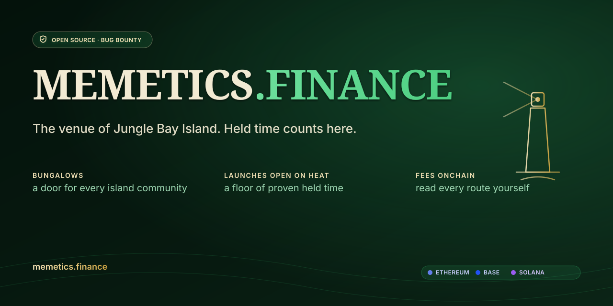

<p align="center">
  
</p>

# memetics.finance

[](../../actions/workflows/ci.yml)
[](../../actions/workflows/contracts-ci.yml)
[](../../actions/workflows/solana-ci.yml)
[](../../actions/workflows/codeql.yml)
[](LICENSE)

**memetics.finance is the venue of Jungle Bay Island.** It is one site where you can swap
memecoins, put them in a pool and earn trading fees, and stake them in each community's own
room. Its home is Solana, on a pool program we run ourselves. A token launcher is built and
waiting to be switched on.

This repository is all of its code: the website, our Solana programs, and the older Ethereum,
Base and Robinhood Chain contracts. The repo, the contracts and the TOWELI token keep the
project's first name, **Tegridy Farms**. Same project.

- **Site:** [memetics.finance](https://memetics.finance)
- **Status below:** read from the chain and the code on 2026-10-16 (UTC).
- **Audits:** none by a paid firm yet. Size what you put in accordingly.

---

## What you can do

| What | Where | Today |
|---|---|---|
| **Swap on Solana** | [/solana](https://memetics.finance/solana) | 🟢 Live. Each trade goes to our own pool when it pays at least as much as Jupiter, and through Jupiter otherwise. Limit orders and DCA run through Jupiter. |
| **Provide liquidity on Solana** | [/solana-lp](https://memetics.finance/solana-lp) | 🟢 Live, on our own pool program. 3 pools: BAYLA/SOL, BAYLA/USDC and SOL/USDC. Anyone can open a new one. |
| **Stake in a room** | [/earn](https://memetics.finance/earn) and each room's door | 🟢 Live. Which pools pay right now: see [Staking](#staking). |
| **Visit the rooms** | [memetics.finance](https://memetics.finance) → Rooms | 🟢 Thirteen bungalows: twelve resident communities, each with its own door, market and staking pool, and one still empty. |
| **Check a token or wallet** | [/trust](https://memetics.finance/trust) | 🟢 Token scanner, deployer history, wallet exposure, Pro Terminal, alerts. A check that could not run says so; it never shows as "safe". |
| **Launch a token on Solana** | [/curve-launch](https://memetics.finance/curve-launch) | ⏸ Built and on mainnet since 2026-09-29, zero launches. Paused on chain, and the site's launch form is off. Switching it on is the owner's call. |
| **Ethereum: TOWELI** | [/swap](https://memetics.finance/swap), [/earn/toweli](https://memetics.finance/earn/toweli) | 🧊 Live and frozen (see [Ethereum](#ethereum-frozen)). |
| **Base and Robinhood Chain** | | 🧊 Contracts deployed 2026-08-25. No pools and no launches on either chain. |

---

## How money moves

### Solana pools: our own venue

Our pool program is a fork of Raydium's constant-product AMM
([`raydium-cp-swap`](https://github.com/raydium-io/raydium-cp-swap), Apache-2.0). The trading
code is Raydium's; the admin keys and names are ours.

- **A pool opened from the site uses the 1% fee tier.** Every swap pays 1%: **0.84% stays in
  the pool** for its liquidity providers and **0.16% is the venue's take**: 0.104% to the venue's
  vault and 0.056% to the island's Workshop (Jungle Bay Island's share, agreed 2026-10-18).
- **How liquidity providers earn:** there is no claim button. The 0.84% stays in the pool, so
  each pool share redeems for more over time. You collect it when you remove liquidity.
- **How the venue earns:** the 0.16% cut, plus **0.15 SOL** paid to the vault by whoever opens
  a new pool.
- **Launch pools** (where a launched token graduates) use a separate 0.25% tier, of which
  0.05% of each swap is the venue's take, shared the same way. None exist yet, because nothing has launched.

The site reads the live rates from the chain on the **Venue AMM** tab
([/pools](https://memetics.finance/pools)). Detail: [`TEGRIDY_FORK.md`](solana/tegridy-amm/TEGRIDY_FORK.md).

### Solana swap

- **Through Jupiter:** the venue takes a **0.5%** fee, paid to the venue's vault, where the
  route allows a fee.
- **Through our own pool:** you pay that pool's fee (above) and nothing on top. A tie on price
  goes to our pool; anything less than a tie goes to Jupiter.

### Solana launcher (built, not open yet)

- A bonding curve. Each trade on the curve pays **1%: half to the token's creator, half to the
  venue's vault.** When a token is created, **3.69% of its supply** goes to the venue's vault.
- At **25 SOL** the curve graduates into one of our own pools, and that pool's LP tokens are
  burned, so its starting liquidity can never be pulled.
- Today: zero launches, paused on chain, and the site's form is off.

### Staking

Stakers earn rewards in the pool's own token, paid from a reward pot that someone has to fund.
A pool whose pot is empty pays nothing and takes no new stakes; each card says which it is.
The venue takes nothing from staking, except the TOWELI pool's early-exit penalty, which goes
to the treasury.

| Pool | Chain | How it works | Today |
|---|---|---|---|
| **BAYLA lock ladder** | Solana, our own program | Lock 7 days to 4 years for a 0.4× to 4.0× reward weight. Leaving early costs the time left on your lock over four years, capped at 75%. That penalty stays in the pool as rewards for everyone else. | 🟢 Paying. 2,000,000 BAYLA of its rewards came from the island's Workshop on 2026-09-24. |
| **TOWELI** | Ethereum | Lock 7 days to 4 years. The weight rises in a straight line from 0.4× to 4.0× (about 1.3× at one year); a JBAC NFT adds 0.5×. Leaving early costs 25%, sent to the treasury. | 🟢 Live |
| **BAYLA lighthouse, BOBO, SOY, BRAINLET, RIZZ** | Solana, on Streamflow | Fixed locks with **no early exit at all**. | 🟢 Live |
| **PEPE, QR, MFER, BNKR, DRB, JBM** | PEPE on Ethereum, the rest on Base | TOWELI's ladder; the 25% early-exit penalty stays in the pool. | ⏸ Deployed but unfunded: all six read a reward rate of 0 on 2026-10-14, so they take no new stakes. Exits still work. |

### Ethereum (frozen)

The owner froze the Ethereum, Base and Robinhood rail in August 2026: new work goes to Solana.
The contracts stay live and usable.

- **TOWELI** is the original token: 1,000,000,000 fixed supply, no mint, ownership renounced.
  Any holder can burn their own. It lives on Ethereum only: no bridge, no wrapped copy, and
  never on Solana.
- **Our TOWELI/WETH pair** charges 0.3% a swap: **0.25% stays with its liquidity providers,
  0.05% goes to the treasury Safe** as LP tokens. That 0.05% cut was switched on 2026-10-16.
  Most TOWELI liquidity sits in the Uniswap V2 pool, where Uniswap's LPs keep the fee.
- **Swaps through our fee router** pay a 0.5% venue fee. A 20% referral share comes off first
  (to the referrer, or the treasury if there is none) and the rest is set aside for TOWELI
  stakers, to be paid out through `RevenueDistributor`. **None of it has been distributed to
  stakers yet.**
- **Also on Ethereum:** NFT loans and NFT pools ([/nft-finance](https://memetics.finance/nft-finance)),
  an NFT marketplace, the Doppler token launcher ([/launch](https://memetics.finance/launch)) and
  our own EVM bonding curve ([/eth-curve](https://memetics.finance/eth-curve), zero launches on
  Ethereum, Base and Robinhood). The governance contracts are deployed, but the app is not wired
  to them yet.

### Base and Robinhood Chain

Both run our DEX (factory, router, price oracle, fee router) and our bonding curve, deployed
2026-08-25. **Both have zero pools and zero launches.** Pool fees on either chain would go to
our fee Safe. There is no TOWELI staking on either chain.

---

## Who holds the keys

- **Solana: a two-signature Squads vault**,
  [`GRMtSxgseKdesExU1BQ22abEspTXV55UPcLaHCd18osd`](https://solscan.io/account/GRMtSxgseKdesExU1BQ22abEspTXV55UPcLaHCd18osd).
  It can upgrade all three of our programs (the pool program, the launcher and the BAYLA lock
  ladder), it sets the fee tiers and the launcher's settings, and it controls the BAYLA ladder
  pool. Every venue fee on Solana lands in its accounts, and spending any of it needs both
  signers. The Streamflow pools are run by a single operator wallet.
- **Ethereum: mostly one key.** The core contracts (staking, the DEX, the fee router) are still
  owned by the deployer wallet. Moving them to a Safe is written up in
  [`SAFE_REHOME_RUNBOOK.md`](docs/SAFE_REHOME_RUNBOOK.md) and not done. The treasury is a
  two-signature Safe, and the EVM curve launchers are owned by two-signature Safes.
- **Reviews:** many internal adversarial reviews ([`AUDITS.md`](docs/AUDITS.md)), no paid
  firm. The pool program's changes from Raydium's (its admin keys; the source also adds one
  instruction that names pool share tokens and one check that keeps the launch fee tier for
  launches, which mainnet ran from 2026-10-23 until a roll-back on 2026-10-24) have had no independent review, and the site says so. Report a security issue privately: [`SECURITY.md`](SECURITY.md).

---

## Key addresses

Every address in full, with its role and status, is in
[`frontend/scripts/addresses.json`](frontend/scripts/addresses.json), which CI checks against
the chain. In the app: [memetics.finance/contracts](https://memetics.finance/contracts).

**Solana**

| What | Address |
|---|---|
| Pool program (our cp-swap fork) | [`EKS4C6xvV9A5DMWaWtVnFvi7ru78EhqRAoddEMpQ2BtT`](https://solscan.io/account/EKS4C6xvV9A5DMWaWtVnFvi7ru78EhqRAoddEMpQ2BtT) |
| Launch program | [`64WBTeNcrSHfmBpiqymyifW6FUNNLvJcuiqF9rXmz4q2`](https://solscan.io/account/64WBTeNcrSHfmBpiqymyifW6FUNNLvJcuiqF9rXmz4q2) |
| BAYLA lock ladder program | [`EJLP5GEJXEyPTdoKbGtp2xJiREJpE4DkHSWbVEs9FfUQ`](https://solscan.io/account/EJLP5GEJXEyPTdoKbGtp2xJiREJpE4DkHSWbVEs9FfUQ) |
| BAYLA lock ladder pool | [`Bq6jovnQhayMjr5RqsezGMxgmF5851mqFAhX6LrsXTXV`](https://solscan.io/account/Bq6jovnQhayMjr5RqsezGMxgmF5851mqFAhX6LrsXTXV) |
| Squads vault (2 of 2) | [`GRMtSxgseKdesExU1BQ22abEspTXV55UPcLaHCd18osd`](https://solscan.io/account/GRMtSxgseKdesExU1BQ22abEspTXV55UPcLaHCd18osd) |
| BAYLA | [`7hmVkPXmVagxoptAEpx4jBzZVHwGLdFj6c1y42qxpump`](https://solscan.io/token/7hmVkPXmVagxoptAEpx4jBzZVHwGLdFj6c1y42qxpump) |

**Ethereum**

| What | Address |
|---|---|
| TOWELI | [`0x420698CFdEDdEa6bc78D59bC17798113ad278F9D`](https://etherscan.io/token/0x420698CFdEDdEa6bc78D59bC17798113ad278F9D) |
| TOWELI staking | [`0xcaDc93E96De58EA554c71ca609974625615E046D`](https://etherscan.io/address/0xcaDc93E96De58EA554c71ca609974625615E046D) |
| Our TOWELI/WETH pair | [`0x55875887B43C2E23aE424AF0FC8606Fdb058a481`](https://etherscan.io/address/0x55875887B43C2E23aE424AF0FC8606Fdb058a481) |
| Fee router | [`0x6d5791A660e79175F74C6D639584C98422d5956E`](https://etherscan.io/address/0x6d5791A660e79175F74C6D639584C98422d5956E) |
| RevenueDistributor | [`0xF993316E2fC079de4358c489A935E01e03E23E17`](https://etherscan.io/address/0xF993316E2fC079de4358c489A935E01e03E23E17) |
| Treasury Safe (2 of 2) | [`0x7D2620243EdAd69Ec81A53c4A063B07995A4Bd7d`](https://etherscan.io/address/0x7D2620243EdAd69Ec81A53c4A063B07995A4Bd7d) |
| EVM bonding curve | [`0xF4Dfa741aD63B3D95dC3Fc10D311caE507CE34dE`](https://etherscan.io/address/0xF4Dfa741aD63B3D95dC3Fc10D311caE507CE34dE) |

**Base and Robinhood Chain**

| What | Base | Robinhood Chain |
|---|---|---|
| DEX factory | [`0x12a249A027AA7DdF184E824b4bb63ba031A39fEC`](https://basescan.org/address/0x12a249A027AA7DdF184E824b4bb63ba031A39fEC) | `0x4B134C08aAF86B6e2A8E097D1039C4e7638806f3` |
| Bonding curve | [`0xa517A1cEfd961c0DDE8155a0Fa870aEE5bb0D060`](https://basescan.org/address/0xa517A1cEfd961c0DDE8155a0Fa870aEE5bb0D060) | `0xA2e7E7Fae91846E4c92af7f4b43b24CDd9aBF4F5` |
| Fee Safe (pool fees) | [`0xfc5D5018E557941A3BB7Ff057d1B0c2eCC09fbf1`](https://basescan.org/address/0xfc5D5018E557941A3BB7Ff057d1B0c2eCC09fbf1) | `0xfc5D5018E557941A3BB7Ff057d1B0c2eCC09fbf1` |

---

## For developers

Branch from **`mvp-launch`**: it is the default branch and the trunk, and merging to it
deploys the site. Node 24 (`.nvmrc`), Foundry for contracts, Anchor for the Solana programs.

```bash
cd frontend
cp .env.example .env   # set VITE_WALLETCONNECT_PROJECT_ID and an RPC
npm ci
npm run dev
```

```bash
cd contracts
forge build
forge test
```

The full build and test recipe CI runs is in [`CLAUDE.md`](CLAUDE.md). Setup and gotchas:
[`docs/DEVELOPING.md`](docs/DEVELOPING.md). How to contribute: [`CONTRIBUTING.md`](CONTRIBUTING.md).

### Repo layout

```
frontend/              the site (Vite + React) and its serverless API (frontend/api)
contracts/             Ethereum, Base and Robinhood contracts (Foundry)
solana/tegridy-amm/    our Solana programs: the cp-swap fork, the launcher, the BAYLA lock ladder
solana/tegridy-clmm/   range pools, a fork of Raydium's CLMM: source only, not deployed
indexer/               Ethereum event indexer (Ponder)
indexer-solana/        Solana event indexer
bot/                   Telegram bot, deployed nowhere yet
scripts/               ops and CI tools
docs/                  live docs; docs/audits/ for reviews, docs/archive/ for old plans
```

### Read next

| Doc | For |
|---|---|
| [`docs/TODO_OPERATOR.md`](docs/TODO_OPERATOR.md) | The one to-do list: everything left, in order |
| [`CHANGELOG.md`](CHANGELOG.md) | What changed for visitors, one line each |
| [`solana/tegridy-amm/TEGRIDY_FORK.md`](solana/tegridy-amm/TEGRIDY_FORK.md) | Our pool program and exactly how it differs from Raydium's |
| [`docs/BAYLA_LADDER_GOLIVE_CHECKLIST.md`](docs/BAYLA_LADDER_GOLIVE_CHECKLIST.md) | The BAYLA lock ladder |
| [`docs/RANGE_POOLS_PLAN.md`](docs/RANGE_POOLS_PLAN.md) | Range pools on our own program |
| [`docs/JUNGLE_BAY_ISLAND_PLAN.md`](docs/JUNGLE_BAY_ISLAND_PLAN.md) | The island and its bungalows |
| [`docs/TOKENOMICS.md`](docs/TOKENOMICS.md) | TOWELI and the Ethereum fee flow |
| [`docs/FAQ.md`](docs/FAQ.md) · [`docs/QUICKSTART.md`](docs/QUICKSTART.md) | New to all this |

---

## License

MIT, see [LICENSE](LICENSE), with three carve-outs: `solana/tegridy-amm/` and
`solana/tegridy-clmm/` are Apache-2.0 because they derive from Raydium, and the airdrop module
is GPL-3.0-or-later. Details: [NOTICE.md](NOTICE.md).

*Not financial advice. DeFi is risky. Read the code, read [SECURITY.md](SECURITY.md), decide for yourself.*
